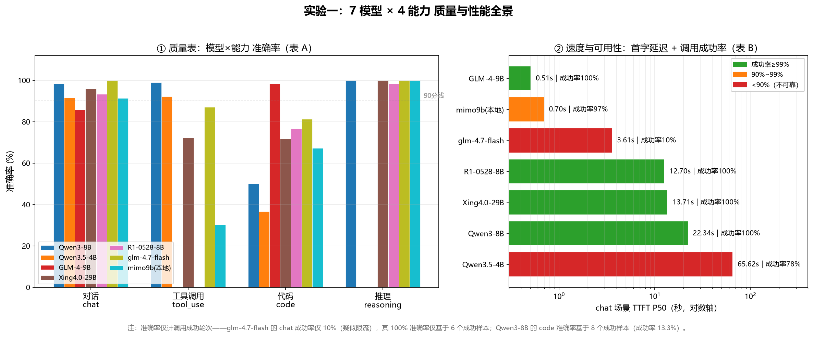
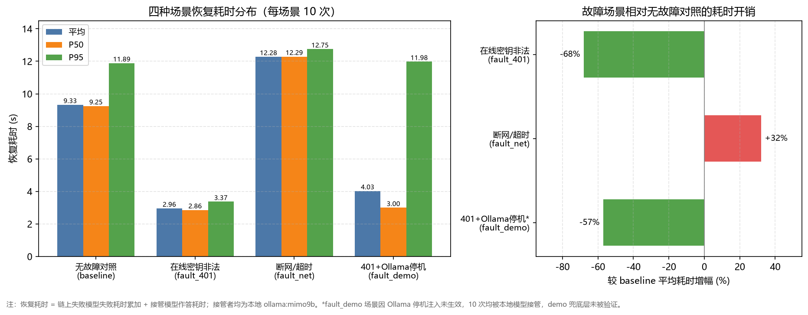

# 安答 Anda · 校园 AI Agent 助手

> 把校园 AI 从「被动问答」升级为「主动服务」的 Agent 系统：自然语言完成课表导入、提醒设置、知识库查询、文档解析、代码生成等操作，系统自动完成意图识别、任务拆解、工具调用与结果汇总。

## 功能特性

- **AI 对话**：SSE 流式输出，思考过程折叠面板，工具调用按真实时间顺序嵌入展示
- **能力权重路由**：多供应商多模型按「0.7 × 质量分 + 0.3 × 等待分」排序调用，质量分来自实测准确率而非人工估计，等待分由健康探活自动量化
- **多级降级链**：模型 Function Calling → 关键词匹配兜底 → 本地 Ollama 离线模型，云端全部失效仍可应答，接口永不抛异常
- **防幻觉闭环**：所有工具必须返回含 `ok` 字段的结果，模型只允许基于真实结果宣称「已完成」；承诺检测识别「口头承诺执行却未调工具」的抖动并强制补执行
- **14 个 Agent 工具**：课表查询/导入、提醒、备忘、ics 日历订阅导出、文档解析、图片理解、图片生成、联网搜索（千帆 → AnySearch → DuckDuckGo 三级聚合 + 故障冷却）、代码生成、导航（POI 优先 + 默认起点兜底）、校园知识库 RAG、翻译
- **主动提醒**：课表课前自动提醒，三重通知（页面 toast + 音频 + 系统级通知）
- **校园知识库 RAG**：走访整理的知识条目经 bge-m3 向量化入库，余弦检索作答
- **工程化细节**：三栏式界面、文件管理器（树形分组/预览/下载/删除二次确认）、PBKDF2 密码哈希、登录注册限流防枚举、上传路径穿越防护

## 架构

```
Frontend    静态 HTML/JS，Vite 开发服务器代理 /api
   │
Backend     FastAPI，routes → service → models 三层
   │
AI 层       模型注册表 models.json · 路由器 model_router.py
   │        编排器 orchestrator.py · 健康检查 health.py
   │        提示词 prompt.json / prompts.py
   │
工具层      tool/*（14 个 Agent 工具，与 REST 接口复用同一套 service）
   │
数据层      app.db（业务库）· Knowledge.db（向量知识库）· Data/uploads
```

- **模型配置**：[AI/models.json](AI/models.json) 按能力（chat / tool_use / reasoning / code / vision / asr / embedding / text_to_image）登记模型，[AI/routes.json](AI/routes.json) 定义能力路由规则，支持跨供应商 fallback 链与热重载
- **本地兜底**：接入 Ollama 的模型登记 `offline` 权重，云端全挂时自动接管

## 快速开始

环境要求：Python 3.11、Node.js；可选：Ollama（本地兜底模型）、cloudflared（公网访问）

```bash
# 1. 后端
pip install -r requirements.txt
copy .env.example .env        # 按 .env.example 填写模型 API Key、SMTP 等配置
python -m Backend.app         # 默认 http://localhost:8000

# 2. 前端
cd Frontend
npm install
npm run dev                   # http://localhost:5173，/api 已反向代理到后端
```

模型 API Key 等环境变量说明见 [.env.example](.env.example)；模型清单与能力权重见 [AI/models.json](AI/models.json)，更换或新增模型只改配置、不动业务代码。

## 实验验证

权重不是拍脑袋填的，配套了两个实验（脚本与数据在 [test/](test/) 目录）：

**实验一 · 能力权重评测**：7 个模型 × chat/tool_use/code/reasoning 四能力 × 各 30 轮。发现手动填写的权重顺序与实测质量序秩差明显（chat 维度 Spearman ρ = −0.750），已按「实验准确率 ÷ 10」回写 models.json。



**实验二 · 降级链故障演练**：40 次故障注入。云端密钥全部失效后本地模型平均 2.96s 接管，断网场景平均 12.28s，四类场景最终成功率 100%。



## 目录结构

```
├── AI/            # 模型注册表、路由器、编排器、健康检查、提示词
├── Backend/       # FastAPI 主体（routes / service / models）
├── Frontend/      # 静态页面 + Vite
├── tool/          # Agent 工具集（14 个）
├── test/          # 三个实验的评测脚本、用例与结果数据
├── docs/          # 项目文档（不入库）
└── Data/          # 运行期数据：SQLite 业务库、向量库、上传文件、日志
```

## 致谢

项目的多模型路由、Agent 编排与 RAG 实现参考了以下工作：

- RouteLLM: Learning to Route LLMs with Preference Data — https://arxiv.org/abs/2406.18665
- FrugalGPT: How to Use Large Language Models While Lowering Cost and Improving Performance — https://arxiv.org/abs/2305.05176
- ReAct: Synergizing Reasoning and Acting in Language Models — https://arxiv.org/abs/2210.03629
- Toolformer: Language Models Can Teach Themselves to Use Tools — https://arxiv.org/abs/2302.04761
- M3-Embedding (BGE-M3) — https://arxiv.org/abs/2402.03216
- Retrieval-Augmented Generation for Knowledge-Intensive NLP Tasks — https://arxiv.org/abs/2005.11401
